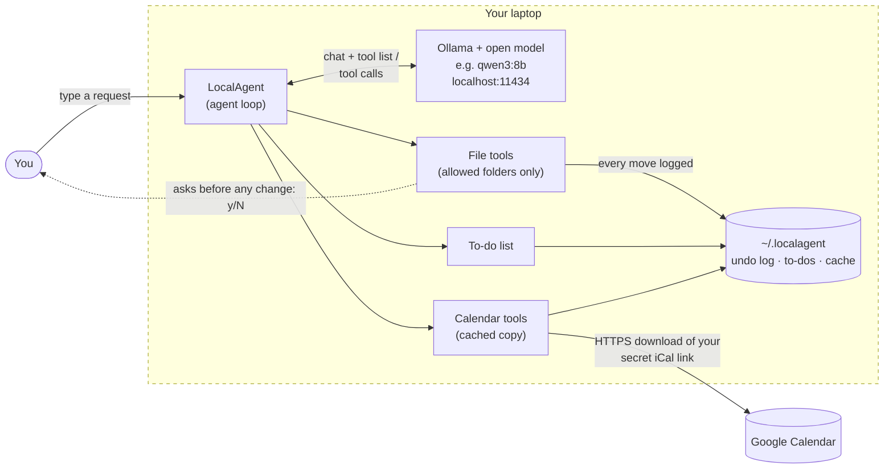
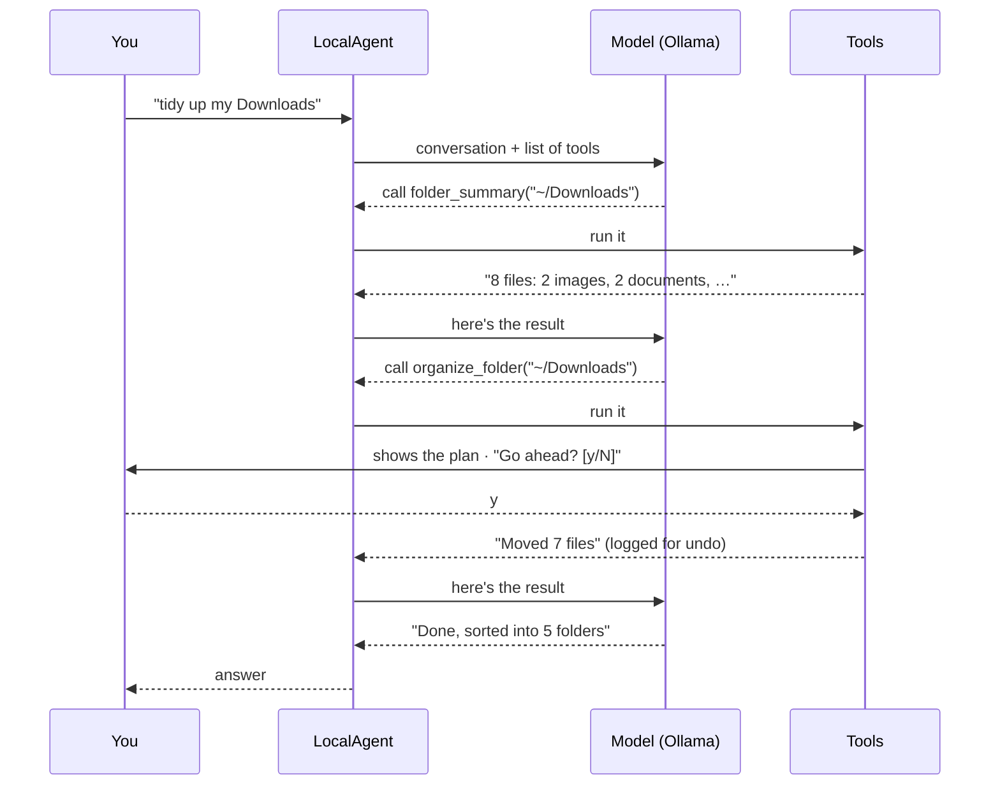

# LocalAgent 🏠

A private AI assistant that runs **entirely on your own laptop**. It can:

- 📂 **Organize your computer**: summarize messy folders, sort Downloads into Images/Documents/Installers…, find big, old or duplicate files, move and rename things, open files
- 📅 **Read your Google Calendar**: "what's on today?", "when is my dentist appointment?", "am I free Thursday afternoon?"
- ✅ **Keep a to-do list**

**No API keys, no accounts, no cloud AI.** The "brain" is a free open model running locally through [Ollama](https://ollama.com). Your files and questions never leave your machine.

```
you › tidy up my downloads
  → folder_summary(path='~/Downloads')
  → organize_folder(folder='~/Downloads', by='type')

⚠  Organize 7 file(s) in ~/Downloads into 5 folder(s) by type?
   Audio/  ←  1 file(s): song.mp3
   Documents/  ←  2 file(s): Invoice_March.pdf, resume_final_v3.docx
   Images/  ←  2 file(s): IMG_2041.HEIC, Screenshot 2026-10-01.png
   Installers/  ←  1 file(s): zoom_installer.dmg
   Videos/  ←  1 file(s): holiday.mp4
   (1 file(s) still downloading are left alone)
   Go ahead? [y/N] y

agent › Done! I sorted 7 files into Audio, Documents, Images, Installers and Videos. Say "undo" to put them back.
```

---

## How it works

Everything inside the dashed box runs on your laptop:



The model can't touch anything by itself. It only **asks** for a tool (e.g. `organize_folder`), and LocalAgent's Python code runs it, with the guard rails below. One request goes round this loop until the model has what it needs:



### What leaves your computer?

| Data | Where it goes |
|---|---|
| Your messages, file names, file contents | **Nowhere.** Only to Ollama on `localhost` (requests skip any proxy). |
| Calendar | LocalAgent *downloads* your calendar from Google every 15 min (that's the only network call). Nothing is uploaded. |
| To-dos, undo history, calendar cache | Stored in `~/.localagent/` on your disk. |

### Safety rails

- 🔒 **Allowed folders only.** The agent can only see the folders listed in your config (default: Desktop, Documents, Downloads, Pictures). Paths are fully resolved first, so `..` tricks and symlinks can't escape.
- ✋ **You approve every change.** Moving, renaming, organizing or undoing shows you the exact plan and waits for `y`.
- ↩️ **Everything is undoable.** Type `/undo` (or ask "undo that") to put the last batch of files back.
- 🗑️ **Nothing is ever deleted.** Duplicates get moved into a `Duplicates (review)` folder for *you* to check.
- 🚫 **Won't run programs.** `open_file` refuses `.exe`, `.dmg`, scripts and other things that would run code.
- ⏳ Half-finished downloads (`.crdownload`, `.part`) are left alone.

---

## Setup (about 10 minutes)

### 1. Install Ollama and download a model

Get Ollama from **https://ollama.com/download** (Windows, macOS, Linux), then in a terminal:

```bash
ollama pull qwen3:8b
```

Pick a model that fits your RAM (all of these can use tools):

| Your laptop's RAM | Model | Download |
|---|---|---|
| 8 GB | `qwen3:4b` | ~2.5 GB |
| 16 GB | `qwen3:8b` (default) or `llama3.1:8b` | ~5 GB |
| 32 GB+ | `qwen3:14b` or `gpt-oss:20b` | 9–14 GB |

### 2. Install LocalAgent (needs Python 3.10+)

**macOS / Linux**
```bash
git clone https://github.com/DaBabaBOI/Claude-stuff.git
cd Claude-stuff/local-agent
python3 -m venv .venv
source .venv/bin/activate
pip install -e .
```

**Windows (PowerShell)**
```powershell
git clone https://github.com/DaBabaBOI/Claude-stuff.git
cd Claude-stuff\local-agent
py -m venv .venv
.venv\Scripts\Activate.ps1
pip install -e .
```

### 3. Create your config

```bash
# macOS / Linux
mkdir -p ~/.localagent && cp config.example.toml ~/.localagent/config.toml

# Windows (PowerShell)
mkdir $HOME\.localagent -Force; copy config.example.toml $HOME\.localagent\config.toml
```

Open `~/.localagent/config.toml` and check the model name and `allowed_folders`.

### 4. Connect Google Calendar (no API key!)

Google gives every calendar a private link that returns it as a standard `.ics` file. No login or key is needed to read it.

1. Open **calendar.google.com** on a computer.
2. Click ⚙ **Settings** (top right) → **Settings**.
3. On the left, under **Settings for my calendars**, click your calendar.
4. Scroll to **Integrate calendar** → copy **Secret address in iCal format**.
5. Paste it into your config:
   ```toml
   [[calendar.sources]]
   name = "Personal"
   url = "https://calendar.google.com/calendar/ical/you%40gmail.com/private-abc123/basic.ics"
   ```
   Add another `[[calendar.sources]]` block for each extra calendar (work, family, holidays…).

> **Treat that link like a password**: anyone with it can read your calendar. If it leaks, click **Reset** next to it in Google Calendar.
> Work/school accounts may have this option turned off by the admin; a downloaded `.ics` file works too (`path = "~/Documents/cal.ics"`).
> Google refreshes this link on its own schedule, so brand-new events can take a little while to show up.

### 5. Check and run

```bash
localagent --check   # tests Ollama, your model, folders and calendars
localagent           # start chatting
```

```
Checking your setup  (config: /Users/you/.localagent/config.toml)
  ✓ Ollama 0.12.0 is running at http://localhost:11434
  ✓ Model 'qwen3:8b' is downloaded
  ✓ Allowed folders: ~/Desktop, ~/Documents, ~/Downloads, ~/Pictures
  ✓ Calendar 'Personal': 12 event(s) in the next 7 days
  ✓ Data folder: ~/.localagent (undo log, to-dos, calendar cache)
All good!
```

You can also ask a single question: `localagent "what's on my calendar tomorrow?"`

---

## Things to try

| Ask | Tool(s) the model uses |
|---|---|
| what's on my calendar today? / this week? | `calendar_events` |
| when is my next dentist appointment? | `calendar_search` |
| am I free tomorrow afternoon for an hour? | `calendar_free_time` |
| what's taking up space in Downloads? | `folder_summary` |
| tidy up my Downloads / sort my Pictures by month | `organize_folder` |
| find PDFs about taxes / videos bigger than 500 MB | `find_files` |
| what haven't I touched in over a year? | `find_files` (older_than_days) |
| are there duplicate photos in Pictures? | `find_duplicates` |
| move all screenshots on my Desktop to Pictures/Screenshots | `move_matching_files` |
| rename IMG_2041.jpg in Downloads to passport.jpg | `rename_file` |
| open my resume | `find_files` → `open_file` |
| how much disk space do I have? | `disk_space` |
| add "renew passport" to my to-do list | `todo` |
| undo that | `undo_last_change` |

**Chat commands:** `/undo` · `/tools` · `/check` · `/reset` (fresh conversation) · `/help` · `/quit`
Add `-v` (`localagent -v`) to see exactly what each tool returned to the model.

---

## Tips & troubleshooting

- **"Can't reach Ollama"**: open the Ollama app (or run `ollama serve`).
- **"Model isn't downloaded"**: run the `ollama pull …` command it prints.
- **It picks the wrong tool or makes things up**: small models aren't perfect. Rephrase more concretely ("list my ~/Downloads folder"), `/reset`, or switch to a bigger model in the config.
- **Slow**: the first message loads the model into memory (can take 10–30 s). After that it's faster. A smaller model or `context_window = 4096` helps on older laptops.
- **Wrong times**: set `timezone = "Asia/Kolkata"` (or yours) under `[calendar]`.

### What it can't do (yet)

- **Create or edit calendar events.** Writing to Google Calendar requires signing in through Google's API (OAuth client credentials), which this project deliberately avoids. Reading via the secret iCal link needs no credentials.
- **Delete files.** On purpose. Things are moved to a review folder instead.

---

## Add your own tool

Tools are plain Python functions. Drop this in `localagent/tools/files.py` (or a new module imported in `tools/__init__.py`) and the model can use it straight away:

```python
@tool(
    "Count how many files of a given type are in a folder.",
    folder={"type": "string", "description": "e.g. ~/Pictures"},
    extension={"type": "string", "description": "e.g. jpg"},
)
def count_files(ctx: Context, folder: str, extension: str) -> str:
    root = ctx.sandbox.resolve(folder)          # enforces the allowed folders
    n = sum(1 for p, _ in scan(root, recursive=True) if ext_of(p) == extension.lower().lstrip("."))
    return f"{n} .{extension} file(s) in {pretty(root)}"
```

The description and parameter descriptions are what the model reads to decide when to call it, so keep them short and concrete. For anything that changes files, build a list of `(source, destination)` moves and hand it to `run_moves(...)`: that gives you the confirmation prompt and undo for free.

## Development

```bash
pip install -e ".[dev]"
pytest
```

The tests cover the sandbox, every file tool (including undo), calendar parsing (recurring events, exceptions, all-day, time zones, offline cache) and the full agent loop against a fake Ollama server.

### Project layout

```
local-agent/
├── config.example.toml     ← copy to ~/.localagent/config.toml
├── localagent/
│   ├── cli.py              ← the chat, /commands, --check, the y/N prompt
│   ├── agent.py            ← the agent loop + system prompt
│   ├── llm.py              ← tiny Ollama client (no extra libraries)
│   ├── safety.py           ← allowed-folder sandbox, undo journal
│   ├── config.py
│   └── tools/
│       ├── __init__.py     ← @tool decorator & registry
│       ├── files.py        ← list/search/organize/move/rename/duplicates/open
│       ├── calendar.py     ← Google Calendar via secret iCal link
│       └── todos.py
└── tests/
```
